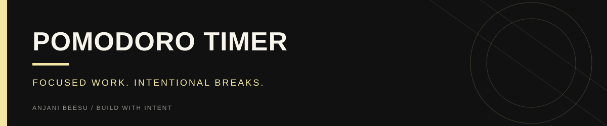

<!-- Visual identity: near-black, warm ivory, and butter yellow. -->

<p align="center">
  
</p>

<p align="right"><sub><a href="https://github.com/AnjaniBeesu">ANJANI BEESU</a> &nbsp; / &nbsp; <a href="https://www.linkedin.com/in/anjanibeesu/">LINKEDIN</a> &nbsp; / &nbsp; <a href="https://portfolio-theta-olive-54.vercel.app/">PORTFOLIO</a></sub></p>

---

# Pomodoro Timer

A minimal and functional productivity timer built using Python and Tkinter.  
This application helps users manage focused work sessions using structured work and break intervals.

---

## Features

- Multiple presets: 25/5, 50/10, and 100/20 work-break cycles  
- Custom cycle input for flexible session planning  
- Day and night mode toggle  
- Circular progress indicator for visual feedback  
- Streak counter to track consistency  
- Subtle tick sound for progress updates  
- Start and reset controls  

---

## Tech Stack

- Python  
- Tkinter (GUI)

---

## How to Run

```bash
python pomodoro_ui.py
